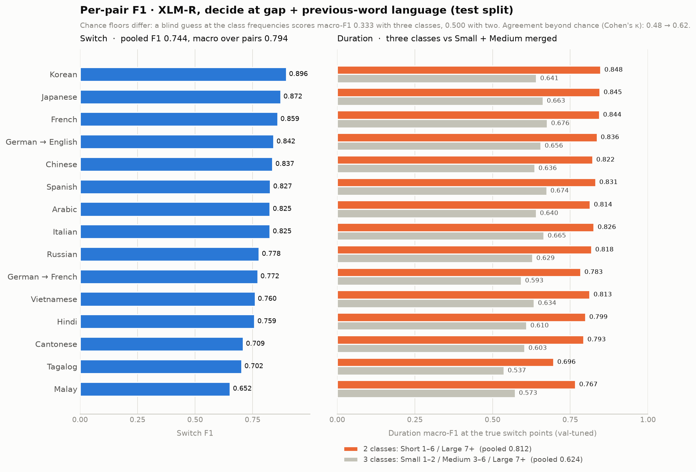
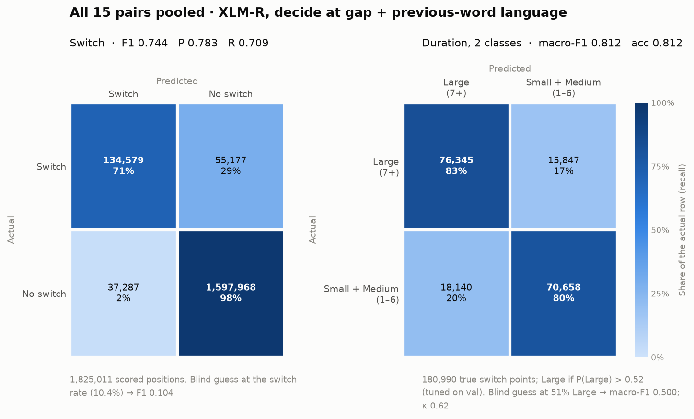

# Group Update #2 — Anticipatory Code-Switch Prediction

This update builds on `docs/groupUpdate1.md`. The grading checklist is in `docs/update2_requirements.md`.

## 1. Design change: the decision point moves past the punctuation

*Recorded 2026-11-03. Full record: `docs/results/2026-11-03_xlmr_prev_gap.md`.*

### What changed

In Update #1, the model decided whether the next word switches language **at the last piece of the current word**. In `home , 然后`, it had to decide at `home`, before reading the comma.

From now on, it decides **at the last piece before the next word that is not a bare space marker** (`--decide-at gap`, `src/anticipation.py: gap_landing`). In `home , 然后`, it decides at the comma. When no punctuation sits between two words, nothing changes.

| | Update #1 (`word`) | Update #2 (`gap`) |
|---|---|---|
| Where the label sits | last piece of the current word | last non-blank piece before the next word |
| `home , 然后` | decides at `home` | decides at `,` |
| `home 然后` (no punctuation) | decides at `home` | decides at `home` (same) |
| Labels (`y_sw`, `y_dur`), number of scored positions | | unchanged; 12.9% of labels move |

### Why

- **59% of switches sit behind punctuation or a speaker turn** (`docs/results/2026-11-01_punct_breakdown.md`). In word mode, the model had to guess both that punctuation was coming and that a switch would follow it. Punctuation is typed before the next word, so a system predicting in real time would already have read it. Deciding after it is the more realistic task.
- **Still causal.** The decision comes before any piece of the next word, and the causality check still passes (drift 0.00e+00). The bare `▁` is never a landing point: XLM-R emits it only before CJK and other characters that don't merge with the marker, so it would reveal the next word's script.

### The cost

- **The warning comes one piece later** whenever punctuation follows a word.
- **Which positions get scored depends on the next piece.** Word mode also peeks one piece ahead, to find where a word ends. In gap mode, that peek also reveals whether punctuation is coming, so words followed by punctuation are never scored. Part of the gain below comes from this redefinition, not from a better model.

### Effect (XLM-R, seed 0, 12k steps, all 15 pairs, previous-word language input)

| | `xlmr_prev` (word) | `xlmr_prev_gap` (gap) | Paired difference [95% CI] |
|---|---:|---:|---|
| Switch F1 | 0.646 | **0.744** | +0.098 [+0.096, +0.100] |
| Macro-F1 over pairs | 0.677 | **0.794** | |
| F1 into L2 / into L1 | 0.536 / 0.760 | 0.634 / 0.858 | |
| Duration macro-F1 (val-tuned) | 0.574 (0.606) | 0.596 (0.624) | +0.022 [+0.020, +0.024] |
| End-to-end accuracy | 0.477 | 0.522 | +0.045 [+0.043, +0.046] |

Where the switch gain comes from (`scripts/gap_split.py`):

| Positions | Share of positions | F1 word → gap | Average precision word → gap |
|---|---:|---|---|
| Moved (label now on the punctuation) | 12.9% | 0.786 → 0.866 | 0.865 → 0.941 |
| Unmoved (no punctuation before the next word) | 87.1% | 0.467 → 0.536 | 0.485 → 0.584 |

- **Moved positions:** the model uses the punctuation it can now see.
- **Unmoved positions:** precision rises from 0.425 to 0.644, because the model no longer hedges at word ends for punctuation it can't see yet.
- **The model beats a simple rule.** "Predict a switch exactly when the label sits on punctuation" gets F1 0.526. That is the simplest baseline at these decision points.

### What this means for the rest of the update

- **Every Update #2 model result uses `--decide-at gap`** (the notebook default is now `DECIDE_AT = "gap"`). The reference run is `xlmr_prev_gap`.
- **Update #1's numbers are a different task.** Quote them as "decided at the word end" and don't compare them directly with gap results.
- **To do:** recompute the training-free baselines (`scripts/baseline_anticipation.py`) at the gap positions, and rerun mBERT with `--decide-at gap` for the backbone comparison (checklist item 3).

### Duration as two classes (Small + Medium merged)

*`scripts/plot_duration_binary.py xlmr_prev_gap`; figures in `docs/figures/chris/gap/`. No retraining: P(Short) = P(Small) + P(Medium), and the Short/Large cut (0.52) is tuned on val.*

| Duration at the true switch points (n = 180,990) | Accuracy | Macro-F1 | Blind-guess macro-F1 | Cohen's κ |
|---|---:|---:|---:|---:|
| 3 classes: Small 1–2 / Medium 3–6 / Large 7+ (val-tuned) | 0.674 | 0.624 | 0.333 | 0.48 |
| 2 classes: Short 1–6 / Large 7+ | **0.812** | **0.812** [0.810, 0.814] | 0.500 | **0.62** |

- **Every pair improves**, from Tagalog 0.537 → 0.696 to Korean 0.641 → 0.848.
- **Part of the gain is real; part comes from the easier task.** Two classes have a higher chance floor (0.500 vs 0.333), so the raw +0.19 macro-F1 overstates it. Agreement beyond chance (κ) is the like-for-like measure, and it rises from 0.48 to 0.62.
- **Medium is the hard class.** In the three-class confusion matrix, true Medium runs are predicted Large 43% of the time, Small 35% and Medium only 22%. Merging Medium away removes the weakest class rather than fixing it.
- **How to report it:** the three classes are the project requirement, so they stay the headline duration result. Report the two-class view alongside it as "can the model tell a short burst (1–6) from a sustained switch (7+)?" It comes from the same model, at no extra cost.

## 1b. Label fix: lexical override on AnE-LID (labels version 2)

*Recorded 2026-11-03. Full record: `docs/results/2026-11-03_lexical_override.md`.*

- **The problem:** AnE-LID was never measured on Malay, Vietnamese or Tagalog, because no human-annotated set exists for them. There it tagged common L1 function words English (`akan`, `yang`, `và`, `của`), inventing switches. Two signals showed it, without hand labels: the tagger consensus, and the trained model refusing those "switches" (recall 0.16–0.18).
- **The fix:** dict-freq now overrules AnE where the evidence is overwhelming: the word must be 100× more frequent in the other language, or carry Vietnamese-only letters. 20,075 tokens change (Malay 2.85% of words, Vietnamese 0.66%, Tagalog 0.14%, others ≤ 0.04%).
- **The validation:** accuracy on LinCE spa-eng and Denglisch is unchanged (99.4% / 99.9%). The rebuild with the override off reproduces version 1 exactly.
- **The effect without retraining:** `xlmr_prev_gap` re-scored on the corrected labels gives Malay 0.652 → 0.703, Vietnamese 0.760 → 0.777, and 0.744 → 0.747 overall.
- **From here on:** Update #2 results use the version-2 labels. Runs on version 1 (everything up to `xlmr_prev_gap`, including the 36k and LoRA runs started 2026-11-03) are compared only with each other.

## 2. Dual-head architecture

*To be written (checklist item 1).*

## 3. Loss function

*To be written (checklist item 2: λ₁ L_sw + λ₂ L_dur, `ignore_index=-1` for the duration head).*

## 4. Experiment A: backbone comparison

*To be written (checklist item 3: mBERT vs XLM-R, both at the gap decision point).*

## 5. Initial universality audit

*To be written (checklist item 4: per-pair anticipatory F1 bar chart). Per-pair gap F1 is in `docs/results/2026-11-03_xlmr_prev_gap.md`.*

## 6. Training convergence

*To be written (checklist item 5: switch vs duration loss curves).*
