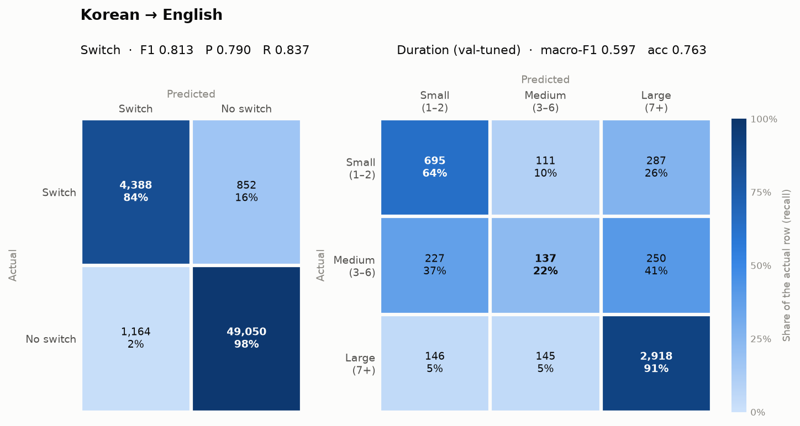

# Team meeting 1: XLM-R on the 6 script-disjoint pairs

Results of XLM-R on the six language pairs whose scripts don't overlap with English: Cantonese, Chinese, Japanese, Korean, Russian and Arabic → English. Because the scripts differ, every word's language label is exact, so these errors are the model's, not the tagger's.

**Run:** `xlmr_6pairs`, Kaggle T4, 2026-10-12.
- **Model:** XLM-R base (277 M parameters) with a causal mask.
- **Training:** 12,000 steps, seed 0, on these 6 pairs only.
- **Data split:** one model trained on the 6 pairs together. Within each pair, 80% of conversations are for training, 10% for tuning (val) and 10% for the reported test scores, scored once per pair.
- **Full record:** [`results/2026-10-12_xlmr_6pairs_duration.md`](results/2026-10-12_xlmr_6pairs_duration.md), with the bootstrap intervals and the class-weighted comparison run.

## How the switch and duration labels were made

SwitchLingua has no word-level language labels, only the text, so every label below is derived automatically, with no hand labelling.

1. **Tag each word with its language.** For these 6 pairs this is the easy case. None of the six first languages uses the Latin alphabet, so each word's Unicode script tells us its language: Han, Kana, Hangul, Cyrillic or Arabic script means the first language (L1), and Latin script means English. No model is needed, and the tags are exact by construction, which is why we picked these pairs for the first results. Punctuation and digits get no language. Names follow the same rule: a Latin-script name ("Netflix") counts as English, and a native-script name counts as L1.
   - **The harder pairs need a model.** In the other 9 pairs (Spanish, French, German, Italian, Malay, Vietnamese, Filipino, romanized Hindi → English), both languages use the Latin alphabet, so script tells us nothing. Those rows were tagged with AnE-LID, a pretrained code-switching language-ID model (dict-frequency tagging for German→French). Those tags are *provisional* rather than exact, and they only matter for the 9 held-out pairs scored below.
   - **Where the labels came from in this run:** nothing was recomputed. The Kaggle notebook downloaded the stored final labels (`tagged.parquet` from `CodeSwitchGroup4/switchlingua-tagged-final` on Hugging Face) and only re-split the text into XLM-R pieces (step 2). That file is byte-identical to our local `data/tagged.parquet` (same SHA-256). It holds the Unicode tags for these 6 pairs and the stored AnE-LID tags for the Latin-script pairs. We checked the 6 pairs' final labels against the bare script rule: all but about 0.04% of words match. The exceptions are a few native-script characters inside names that the names rule counts as English.
2. **Map the tags onto XLM-R's sub-word pieces.** The original text is split with the XLM-R tokenizer, and each piece takes the language of the word its characters come from. Punctuation, digits and XLM-R's bare `▁` space piece are marked *no language*: they neither break nor extend a run, and are never scored.
3. **Derive the two labels at every piece t**, looking only at the pieces after t:
   - **Switch** = 1 if the next language-bearing piece is in the other language, else 0. The last piece of each conversation has no next piece, so it gets no label (masked, not set to 0).
   - **Duration** (only where switch = 1) = how many pieces the new-language stretch lasts before the language changes back: **Small** 1–2, **Medium** 3–6, **Large** 7+. If the text ends before the stretch does, we only know a lower bound, so the point is scored only once that bound reaches 7 (it is certainly Large); otherwise its duration is left out.

**Example** (Cantonese → English), as XLM-R splits it:

| Piece | 我 | 今日 | 好 | 忙 | , | 要 | 準備 | 個 | ▁presentation | ▁for | ▁tomorrow | ▁ | 啊 | 。 |
|---|---|---|---|---|---|---|---|---|---|---|---|---|---|---|
| Language | L1 | L1 | L1 | L1 | — | L1 | L1 | L1 | EN | EN | EN | — | L1 | — |
| Switch label | 0 | 0 | 0 | 0 | — | 0 | 0 | **1** | 0 | 0 | **1** | — | — | — |
| Duration label | | | | | | | | **Medium** (3) | | | unscored | | | |

At 個 the model must predict that English comes next and lasts 3 pieces (Medium). At ▁tomorrow the switch back to 啊 is scored, but its duration isn't: the text ends after 1 piece, so the stretch could have been Small, Medium or Large. 啊 is the last language-bearing piece, so it has no label. The model is never given the language row; it sees only the pieces.

## What we trained on and what we evaluated on

**One model for all 6 pairs, scored on each pair separately.** We did *not* train one model per language. A single XLM-R was fine-tuned on the 6 pairs pooled together, then that same model was scored on each pair's own test conversations. Every per-pair number in this document comes from that one model.

**The split is 80 / 10 / 10 within every pair.** Each conversation goes to one split by its `row_id` (`row_id % 10`: 0–7 train, 8 val, 9 test). It is assigned by conversation, never by token, so no conversation is split across train and test. Because the rule is the same for every row, each pair's test set is 10% of that pair's own conversations:

| Pair | Conversations | Train (80%) | Val (10%) | Test (10%) | Test positions scored |
|---|---:|---:|---:|---:|---:|
| Cantonese | 119,248 | 95,398 | 11,925 | 11,925 | 1,061,851 |
| Arabic | 8,548 | 6,840 | 854 | 854 | 51,395 |
| Chinese | 8,458 | 6,766 | 846 | 846 | 62,016 |
| Japanese | 8,385 | 6,708 | 839 | 838 | 64,510 |
| Korean | 8,266 | 6,613 | 826 | 827 | 55,454 |
| Russian | 8,017 | 6,413 | 802 | 802 | 49,679 |
| **All 6** | **160,922** | **128,738** | **16,092** | **16,092** | **1,344,905** |

- **Train (80%):** the only data the model learns from. 12,000 steps of 16 windows is about 1.5 passes over these conversations. Cantonese is 74% of the training conversations, because SwitchLingua has far more Cantonese than any other pair; the training batches are not rebalanced.
- **Val (10%):** never trained on. It sets the decision rules only: the switch threshold (one value, 0.377, shared by all pairs) and the 3 duration offsets.
- **Test (10%):** never trained on and never used for any choice. It is scored once, at the end, and each pair is reported on its own slice. The "all 6, pooled" rows weight every test position equally, so they are dominated by Cantonese. The "average over pairs" rows weight each pair equally.

**What the model is not told.** The input is the text pieces only: no language tags, and no indication of which pair a conversation belongs to. The model has to work out the pair from the text itself.

**Other checks:**
- **The 9 held-out Latin-script pairs, scored zero-shot,** as a transfer check (their own test 10%): F1 0.514 (average over pairs 0.520, from 0.394 for German→French to 0.585 for Vietnamese→English). An earlier model trained on all 15 pairs scored 0.659 on them, so the 6-pair model keeps about 78% without ever seeing a Latin-script switch.
- **Training on all 15 pairs instead doesn't change these 6.** The earlier all-15-pairs model scored average F1 0.698 on these 6 pairs, against 0.703 here, within run-to-run noise.

## How the model makes its predictions

The model reads a conversation one sub-word piece at a time, as an XLM-R tokenizer splits it. It sees only the pieces themselves: no language tags, and not which language pair it is reading. At every piece it makes two predictions about the *next* piece: will it switch language (**switch**), and if so, how long will the new-language stretch last: Small (1–2 pieces), Medium (3–6) or Large (7+) (**duration**). The whole conversation (up to 384 pieces) goes through the model in one pass, but a causal attention mask means the prediction at piece t can only draw on pieces 1…t. That is the same as feeding it each prefix separately. Before training, an automated check replaces every later piece with random ones and confirms the earlier predictions don't change at all (drift 0.0). The labels come from the next piece, so the model can never see the answer it is asked for.

**Switch:** the model outputs a probability, and we call a switch when it is at least 0.377. That threshold was chosen on the val split to maximise F1, then applied unchanged to test. Punctuation, digits and the final piece of each conversation are never scored. **Duration** is scored only where a switch really happens and its length class is certain (a stretch cut off by the end of the text counts only once it has reached 7+ pieces). The model's three class probabilities are adjusted by one offset per class, also fitted on val, which stops it defaulting to Large, the majority class. So the duration numbers answer "given that a switch is coming, how long will it last?" (the switch is known in advance), not the end-to-end question.

## Summary

**Switch prediction** (all 6 pairs: F1 0.645, precision 0.657, recall 0.634; average over the pairs 0.703):

| Pair | Test positions | True switches | F1 | Precision | Recall | Accuracy |
|---|---:|---:|---:|---:|---:|---:|
| Korean | 55,454 | 5,240 | **0.813** | 0.790 | 0.837 | 0.964 |
| Japanese | 64,510 | 5,658 | **0.741** | 0.713 | 0.771 | 0.953 |
| Chinese | 62,016 | 5,942 | **0.702** | 0.658 | 0.752 | 0.939 |
| Arabic | 51,395 | 4,908 | **0.669** | 0.647 | 0.692 | 0.934 |
| Russian | 49,679 | 4,677 | **0.666** | 0.656 | 0.675 | 0.936 |
| Cantonese | 1,061,851 | 104,881 | **0.625** | 0.647 | 0.605 | 0.928 |

**Accuracy is not the headline number.** About 90% of positions are "no switch", so always predicting "no switch" already scores about 0.90. F1, precision and recall on the switch class are the measures that matter.

**Switch direction.** A switch either goes *into English* (the current piece is in the first language) or goes *back into the first language* (the current piece is English). Going back is easier on 5 of the 6 pairs: once an English stretch has run a few pieces, its end is predictable. Going into English means anticipating from content alone, and that is the core research question.

| Pair | Into English: F1 (P / R) | Back into L1: F1 (P / R) | Gap |
|---|---|---|---:|
| Korean | **0.822** (0.841 / 0.804) | 0.803 (0.737 / 0.882) | +0.019 |
| Japanese | 0.712 (0.713 / 0.711) | 0.775 (0.713 / 0.849) | −0.063 |
| Chinese | 0.646 (0.625 / 0.670) | 0.767 (0.694 / 0.858) | −0.121 |
| Russian | 0.594 (0.606 / 0.582) | 0.754 (0.714 / 0.798) | −0.160 |
| Arabic | 0.586 (0.598 / 0.573) | 0.768 (0.698 / 0.854) | −0.182 |
| Cantonese | **0.444** (0.538 / 0.378) | 0.784 (0.719 / 0.862) | −0.340 |
| **All 6, pooled** | **0.499** (0.576 / 0.440) | **0.782** (0.717 / 0.860) | −0.283 |
| Average over pairs | 0.634 | 0.775 | −0.141 |

- **Read the pooled row with care.** Cantonese accounts for 55,791 of the 70,770 switches into English, so the pooled 0.499 mostly reflects Cantonese. The average over pairs (0.634) is fairer to the other five.
- **Recall is what drops.** Going back into L1, the model catches 80–88% of switches. Going into English it catches 38–80%: the model hesitates rather than raising false alarms.
- **Korean is the exception.** Korean particles attach straight onto English words, so the piece itself often announces the coming switch.
- **Cantonese is the main problem.** It catches only 38% of its switches into English, and it is half the test data.

**Duration prediction** (all 6 pairs: accuracy 0.663, macro-F1 0.602; n = 125,675 true switch points):

| Pair | Switch points | Accuracy | Macro-F1 | Within one class |
|---|---:|---:|---:|---:|
| Korean | 4,916 | 0.763 | **0.597** | 0.912 |
| Japanese | 5,377 | 0.778 | **0.623** | 0.941 |
| Chinese | 5,623 | 0.729 | **0.607** | 0.946 |
| Arabic | 4,562 | 0.705 | **0.596** | 0.927 |
| Russian | 4,363 | 0.701 | **0.593** | 0.920 |
| Cantonese | 100,834 | 0.645 | **0.598** | 0.939 |

- **Macro-F1** averages the three classes equally, so a model that ignores Medium can't score well on it.
- **Within one class** counts a prediction as close if it is off by at most one class (Small↔Medium or Medium↔Large).
- **Compare duration within a script only:** Chinese, Japanese, Korean and Cantonese runs count characters, while Russian and Arabic count words.

## Compared with no training

Baselines that need no model training, scored on the same test positions. The count-based ones fit their tables on the train split.

- **Untrained XLM-R** (`xlmr_untrained_6pairs`, `kaggle/untrained_xlmr.ipynb`): pretrained XLM-R exactly as downloaded, with randomly initialised switch and duration heads and 0 training steps. Only the switch threshold and the 3 duration offsets are fit on val. This is the starting point of fine-tuning.
- **Always switch:** predict a switch at every piece.
- **Naive (current language):** predict a switch whenever the current piece is English, i.e. "English stretches end". One bit of context.
- **Run-length hazard:** P(switch | current language, how long the current stretch has run, the pair), with a val-tuned threshold. Duration: the most common class for that pair and direction.
- **Piece lookup:** P(switch | the current piece), a table with one probability per XLM-R piece, plus the most common duration class after that piece. This is the best you can do from the current piece alone.

**Switch F1:**

| Pair | Untrained XLM-R | Always switch | Naive | Run-length hazard | Piece lookup | **Fine-tuned XLM-R** | Fine-tuned − untrained | Fine-tuned − lookup |
|---|---:|---:|---:|---:|---:|---:|---:|---:|
| Korean | 0.128 | 0.173 | 0.177 | 0.265 | 0.610 | **0.813** | +0.685 | +0.203 |
| Japanese | 0.149 | 0.161 | 0.156 | 0.244 | 0.495 | **0.741** | +0.592 | +0.246 |
| Chinese | 0.136 | 0.175 | 0.161 | 0.242 | 0.399 | **0.702** | +0.566 | +0.303 |
| Arabic | 0.134 | 0.174 | 0.175 | 0.246 | 0.390 | **0.669** | +0.535 | +0.279 |
| Russian | 0.137 | 0.172 | 0.183 | 0.245 | 0.391 | **0.666** | +0.529 | +0.275 |
| Cantonese | 0.151 | 0.180 | 0.244 | 0.251 | 0.417 | **0.625** | +0.474 | +0.208 |
| **All 6, pooled** | 0.148 | 0.178 | 0.225 | 0.251 | 0.427 | **0.645** | +0.497 | +0.218 |
| **Average over pairs** | 0.139 | 0.173 | 0.183 | 0.249 | 0.450 | **0.703** | +0.564 | +0.253 |

**Duration macro-F1** (at true switch points; XLM-R val-tuned):

| Pair | Untrained XLM-R | Most common class | Piece lookup | **Fine-tuned XLM-R** | Fine-tuned − untrained | Fine-tuned − lookup |
|---|---:|---:|---:|---:|---:|---:|
| Korean | 0.288 | 0.263 | 0.431 | **0.597** | +0.309 | +0.166 |
| Japanese | 0.286 | 0.271 | 0.464 | **0.623** | +0.337 | +0.159 |
| Chinese | 0.339 | 0.261 | 0.405 | **0.607** | +0.268 | +0.202 |
| Arabic | 0.329 | 0.254 | 0.400 | **0.596** | +0.267 | +0.196 |
| Russian | 0.318 | 0.254 | 0.396 | **0.593** | +0.275 | +0.197 |
| Cantonese | 0.315 | 0.388 | 0.479 | **0.598** | +0.283 | +0.119 |
| **All 6, pooled** | 0.315 | 0.390 | 0.473 | **0.602** | +0.287 | +0.129 |

**Untrained XLM-R in detail** (test split; the same 1,344,905 positions and 125,675 duration points as the fine-tuned run, so every comparison is paired):

| | Untrained XLM-R | Fine-tuned XLM-R |
|---|---:|---:|
| Switch F1 (P / R), all 6 pooled | 0.148 (0.089 / 0.454) | 0.645 (0.657 / 0.634) |
| Switch accuracy | 0.491 | 0.932 |
| Into English / back into L1 F1 | 0.131 / 0.183 | 0.499 / 0.782 |
| Duration accuracy / macro-F1 (val-tuned) | 0.355 / 0.315 | 0.663 / 0.602 |
| Duration F1 Small / Medium / Large | 0.243 / 0.226 / 0.476 | 0.599 / 0.406 / 0.802 |
| Duration within one class | 0.739 | 0.937 |
| End to end (switch predicted *and* class right) | 0.164 | 0.445 |
| 9 Latin-script pairs, zero-shot switch F1 | 0.193 | 0.514 |

- **It is at chance, as expected.** A random head has nothing to read the pretrained features with. Precision 0.089 is just under the 0.098 switch base rate, so its "switch" calls are no better than random picks. The val-tuned threshold (0.448) then flags about half of all positions to reach 45% recall, which is why accuracy falls to 0.49.
- **It scores below even "always switch"** (0.148 vs 0.178): flagging half the positions at random gets fewer true switches than flagging all of them, at a similar precision.
- **Duration is near chance too.** Whatever the true class, it predicts about 27% Small, 27% Medium and 46% Large: the prediction ignores the answer. Guessing uniformly at random would give macro-F1 about 0.32; it scores 0.315.

**How much did fine-tuning help?**
- **Switch: from 0.25 to 0.70 average F1 against the run-length baseline, and +0.25 over the piece lookup.** The lookup shows how much a single piece gives away (Korean particles make it 0.610 on its own); everything XLM-R adds on top comes from reading the context before it. The gain is largest on Chinese, Arabic and Russian (+0.28 to +0.30), where the current piece says least.
- **Duration: +0.12 to +0.20 macro-F1 over the piece lookup.** The baselines barely predict Medium (lookup Medium F1 0.11 pooled; the most-common-class baseline never predicts it). XLM-R reaches 0.41.
- **Accuracy would hide all of this:** always predicting "no switch" scores about 0.90 accuracy and F1 0.
- **From the untrained starting point, fine-tuning adds +0.56 average switch F1 (0.139 → 0.703) and +0.29 duration macro-F1 (0.315 → 0.602).** That is the whole gain of training, but the untrained model is a floor, not a fair bar: it is at chance by construction, below even the trivial baselines. The bar a trained model has to clear is the piece lookup.
- **Still to come: the linear probe** (`xlmr_probe_6pairs`, same notebook): XLM-R frozen, only the two heads trained. It will split the gain into what pretrained XLM-R already knows (probe − untrained) and what adapting the model itself adds (fine-tuned − probe).

## Per-pair detail

Each pair has two confusion matrices: switch on all test positions, and duration (Small / Medium / Large) at true switch points. Precision and recall in the duration table are per class.

**Reading the figures:** rows are the actual class, columns the prediction. Each cell shows its count and its share of the row, so the diagonal is the recall of each class. Colour encodes that share, not the raw count, on one 0–100% scale shared by every panel. Raw counts would make a useless colour scale, because "no switch, predicted no switch" is about 50× every other cell. The figures come from `scripts/plot_confusion.py data/anticipation_xlmr_6pairs.json --out docs/figures/chris/team_meeting1`.

### Korean → English

**Switch** (F1 0.813, precision 0.790, recall 0.837, accuracy 0.964):

| | Predicted switch | Predicted no switch |
|---|---:|---:|
| **Actual switch** | 4,388 | 852 |
| **Actual no switch** | 1,164 | 49,050 |

**Duration** (accuracy 0.763, macro-F1 0.597):

| Actual \ predicted | Small | Medium | Large | Precision | Recall | F1 |
|---|---:|---:|---:|---:|---:|---:|
| **Small (1–2)** | 695 | 111 | 287 | 0.651 | 0.636 | 0.643 |
| **Medium (3–6)** | 227 | 137 | 250 | 0.349 | 0.223 | 0.272 |
| **Large (7+)** | 146 | 145 | 2,918 | 0.845 | 0.909 | 0.876 |

### Japanese → English

**Switch** (F1 0.741, precision 0.713, recall 0.771, accuracy 0.953):

| | Predicted switch | Predicted no switch |
|---|---:|---:|
| **Actual switch** | 4,365 | 1,293 |
| **Actual no switch** | 1,755 | 57,097 |

**Duration** (accuracy 0.778, macro-F1 0.623):

| Actual \ predicted | Small | Medium | Large | Precision | Recall | F1 |
|---|---:|---:|---:|---:|---:|---:|
| **Small (1–2)** | 657 | 143 | 178 | 0.653 | 0.672 | 0.662 |
| **Medium (3–6)** | 209 | 207 | 308 | 0.365 | 0.286 | 0.321 |
| **Large (7+)** | 140 | 217 | 3,318 | 0.872 | 0.903 | 0.887 |

### Chinese → English

**Switch** (F1 0.702, precision 0.658, recall 0.752, accuracy 0.939):

| | Predicted switch | Predicted no switch |
|---|---:|---:|
| **Actual switch** | 4,470 | 1,472 |
| **Actual no switch** | 2,326 | 53,748 |

**Duration** (accuracy 0.729, macro-F1 0.607):

| Actual \ predicted | Small | Medium | Large | Precision | Recall | F1 |
|---|---:|---:|---:|---:|---:|---:|
| **Small (1–2)** | 499 | 255 | 206 | 0.612 | 0.520 | 0.562 |
| **Medium (3–6)** | 222 | 410 | 416 | 0.411 | 0.391 | 0.401 |
| **Large (7+)** | 95 | 332 | 3,188 | 0.837 | 0.882 | 0.859 |

### Arabic → English

**Switch** (F1 0.669, precision 0.647, recall 0.692, accuracy 0.934):

| | Predicted switch | Predicted no switch |
|---|---:|---:|
| **Actual switch** | 3,397 | 1,511 |
| **Actual no switch** | 1,857 | 44,630 |

**Duration** (accuracy 0.705, macro-F1 0.596):

| Actual \ predicted | Small | Medium | Large | Precision | Recall | F1 |
|---|---:|---:|---:|---:|---:|---:|
| **Small (1–2)** | 526 | 248 | 181 | 0.614 | 0.551 | 0.581 |
| **Medium (3–6)** | 177 | 297 | 321 | 0.366 | 0.374 | 0.370 |
| **Large (7+)** | 154 | 266 | 2,392 | 0.827 | 0.851 | 0.838 |

### Russian → English

**Switch** (F1 0.666, precision 0.656, recall 0.675, accuracy 0.936):

| | Predicted switch | Predicted no switch |
|---|---:|---:|
| **Actual switch** | 3,157 | 1,520 |
| **Actual no switch** | 1,653 | 43,349 |

**Duration** (accuracy 0.701, macro-F1 0.593):

| Actual \ predicted | Small | Medium | Large | Precision | Recall | F1 |
|---|---:|---:|---:|---:|---:|---:|
| **Small (1–2)** | 554 | 205 | 164 | 0.583 | 0.600 | 0.591 |
| **Medium (3–6)** | 210 | 258 | 278 | 0.357 | 0.346 | 0.351 |
| **Large (7+)** | 187 | 259 | 2,248 | 0.836 | 0.834 | 0.835 |

### Cantonese → English

**Switch** (F1 0.625, precision 0.647, recall 0.605, accuracy 0.928):

| | Predicted switch | Predicted no switch |
|---|---:|---:|
| **Actual switch** | 63,439 | 41,442 |
| **Actual no switch** | 34,682 | 922,288 |

**Duration** (accuracy 0.645, macro-F1 0.598):

| Actual \ predicted | Small | Medium | Large | Precision | Recall | F1 |
|---|---:|---:|---:|---:|---:|---:|
| **Small (1–2)** | 14,537 | 6,994 | 3,634 | 0.618 | 0.578 | 0.597 |
| **Medium (3–6)** | 6,505 | 10,478 | 7,388 | 0.399 | 0.430 | 0.414 |
| **Large (7+)** | 2,470 | 8,769 | 40,059 | 0.784 | 0.781 | 0.783 |

## Takeaways

- **Fine-tuning earns its keep.** Untrained, XLM-R is at chance (average switch F1 0.139, duration macro-F1 0.315). Fine-tuned, it reaches 0.703 and 0.602, well past the best no-training baseline (piece lookup, 0.450 and 0.473). The gain over the lookup is the context: the lookup already knows everything the current piece gives away.
- **Switching into English is the weak direction** on 5 of 6 pairs (average over pairs 0.634 vs 0.775 back into L1). The gap ranges from −0.06 (Japanese) to −0.34 (Cantonese), and Korean is the exception (+0.02). This is where improvements matter most.
- **Switch F1 ranges from 0.625 (Cantonese) to 0.813 (Korean).** Korean particles attach directly to English words, so a switch is easy to anticipate. Cantonese switches mid-clause, rarely at punctuation, and is half the test data.
- **Duration: Large is easy (F1 0.78–0.89), Medium is hard (0.27–0.41).** Medium is mostly confused with its neighbours, and 91–95% of predictions are within one class. Medium is weakest on Korean and Japanese, where only 12.5% and 13.5% of switches are Medium.
- **Class-weighted duration training changed neither the switch scores nor, after val tuning, the duration scores** (see the full record). We use the plain model plus tuning.

## Next steps: improving XLM-R beyond more training

**Convergence.** The training loss is still falling slowly (0.392 at step 6,000, 0.373 at 12,000), and part of the late drop is the learning-rate decay at the end of the schedule. 12,000 steps is about 1.5 passes over the training conversations. More steps will likely help a little, but the ideas below target other limits.

Ranked by expected gain per GPU hour:

1. **Run the queued input flags:** the previous word's language as input, and predicting at word ends only. In the local ablations these were the only changes that improved both switch F1 (+0.023) and duration. Word-end prediction also stops the model scoring mid-word positions, where a switch can't happen.
2. **Rebalance the training mix.** Cantonese is 74% of training conversations and 79% of the switches into English, so one pair largely sets the loss. Options: sample the pairs more evenly, or up-weight the switches into English, where recall drops most (0.38–0.80 against 0.80–0.88 back into L1).
3. **Stop computing on padding.** Every window is padded to 384 pieces, but the median conversation is 102, so roughly 70% of each batch is padding. Grouping conversations of similar length, or trimming each batch to its longest window, could make steps about 2–3× faster: more data for the same GPU time.
4. **Try a backbone pretrained causally.** XLM-R was pretrained reading both directions, and our causal mask is new to it. A multilingual decoder language model (e.g. Qwen2.5-0.5B, BLOOM-560m, mGPT) was trained on exactly this kind of next-token prediction. It also gives a training-free baseline: the probability that its next token is Latin script. The linear-probe run (`xlmr_probe_6pairs`) will show how much XLM-R's frozen features already carry, which helps decide whether the swap is worth it.
5. **Extra training targets, free from our labels:** "is there a switch within the next k pieces", and the run length as a number. These should sharpen the duration features, especially Medium, at little cost.
6. **A small MLP head instead of a single linear layer**, and layer-wise learning-rate decay. Both are cheap; expect small gains.
7. **Seeds and a small ensemble.** Averaging 3 seeds usually adds about +0.01, and Week 12 needs multiple seeds for the variance analysis anyway.

**A ceiling on duration.** How long the English stretch lasts depends on words not written yet, so Medium F1 will stay well below Large whatever we do.

**First, an error analysis** (local, from the saved predictions, no GPU): F1 by distance since the last switch, and at punctuation vs mid-clause. It would test whether Cantonese's weak switches into English come from mid-clause switching, and show which of the steps above to prioritise.
