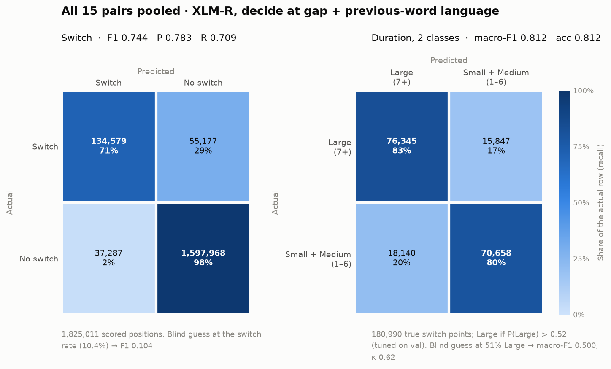
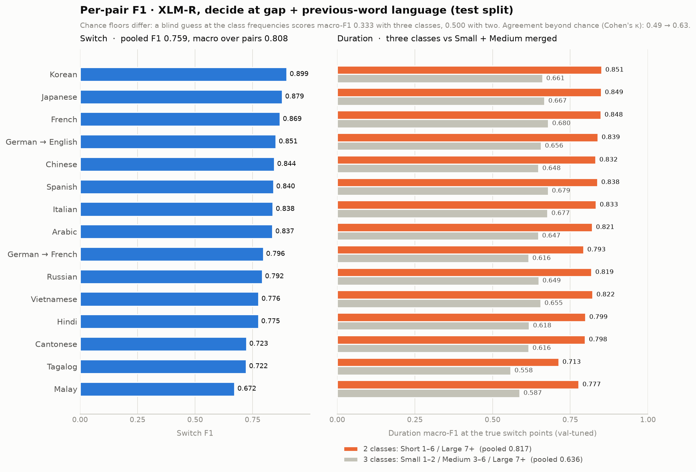
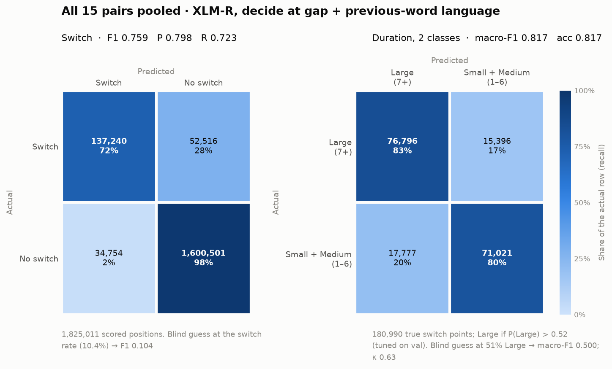
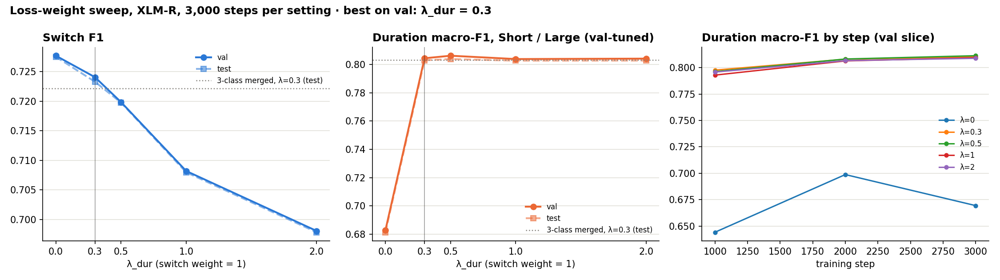

# Group Update #2 — Anticipatory Code-Switch Prediction

This update builds on `docs/updates/groupUpdate1.md`.

## 1. Design change: the decision point moves past the punctuation

*Recorded 2026-11-03. Full record: `docs/results/2026-11-03_xlmr_prev_gap.md`.*

### What changed

In Update #1, the model decided whether the next word switches language **at the last piece of the current word**. In `home , 然后`, it had to decide at `home`, before reading the comma.

From now on, it decides **at the last piece before the next word that is not a bare space marker** (`--decide-at gap`, `src/anticipation.py: gap_landing`). In `home , 然后`, it decides at the comma. When no punctuation sits between two words, nothing changes.

| | Update #1 (`word`) | Update #2 (`gap`) |
|---|---|---|
| Where the label sits | last piece of the current word | last non-blank piece before the next word |
| `home , 然后` | decides at `home` | decides at `,` |
| `home 然后` (no punctuation) | decides at `home` | decides at `home` (same) |
| Labels (`y_sw`, `y_dur`), number of scored positions | | unchanged; 12.9% of labels move |

### Why

- **59% of switches sit behind punctuation or a speaker turn** (`docs/results/2026-11-01_punct_breakdown.md`). In word mode, the model had to guess both that punctuation was coming and that a switch would follow it. Punctuation is typed before the next word, so a system predicting in real time would already have read it. Deciding after it is the more realistic task.
- **Still causal.** The decision comes before any piece of the next word, and the causality check still passes (drift 0.00e+00). The bare `▁` is never a landing point: XLM-R emits it only before CJK and other characters that don't merge with the marker, so it would reveal the next word's script.

### The cost

- **The warning comes one piece later** whenever punctuation follows a word.
- **Which positions get scored depends on the next piece.** Word mode also peeks one piece ahead, to find where a word ends. In gap mode, that peek also reveals whether punctuation is coming, so words followed by punctuation are never scored. Part of the gain below comes from this redefinition, not from a better model.

### Effect (XLM-R, seed 0, 12k steps, all 15 pairs, previous-word language input)

| | `xlmr_prev` (word) | `xlmr_prev_gap` (gap) | Paired difference [95% CI] |
|---|---:|---:|---|
| Switch F1 | 0.646 | **0.744** | +0.098 [+0.096, +0.100] |
| Macro-F1 over pairs | 0.677 | **0.794** | |
| F1 into L2 / into L1 | 0.536 / 0.760 | 0.634 / 0.858 | |
| Duration macro-F1 (val-tuned) | 0.574 (0.606) | 0.596 (0.624) | +0.022 [+0.020, +0.024] |
| End-to-end accuracy | 0.477 | 0.522 | +0.045 [+0.043, +0.046] |

Where the switch gain comes from (`scripts/analysis/gap_split.py`):

| Positions | Share of positions | F1 word → gap | Average precision word → gap |
|---|---:|---|---|
| Moved (label now on the punctuation) | 12.9% | 0.786 → 0.866 | 0.865 → 0.941 |
| Unmoved (no punctuation before the next word) | 87.1% | 0.467 → 0.536 | 0.485 → 0.584 |

- **Moved positions:** the model uses the punctuation it can now see.
- **Unmoved positions:** precision rises from 0.425 to 0.644, because the model no longer hedges at word ends for punctuation it can't see yet.
- **The model beats a simple rule.** "Predict a switch exactly when the label sits on punctuation" gets F1 0.526. That is the simplest baseline at these decision points.

### What this means for the rest of the update

- **Every Update #2 model result uses `--decide-at gap`** (the notebook default is now `DECIDE_AT = "gap"`). The reference run is `xlmr_prev_gap`.
- **Update #1's numbers are a different task.** Quote them as "decided at the word end" and don't compare them directly with gap results.
- **To do:** recompute the training-free baselines (`scripts/training/baseline_anticipation.py`) at the gap positions, and rerun mBERT with `--decide-at gap` for the backbone comparison (checklist item 3).

### Duration as two classes (Small + Medium merged)

*`scripts/plots/plot_duration_binary.py xlmr_prev_gap`; figures in `docs/figures/chris/gap/`. No retraining: P(Short) = P(Small) + P(Medium), and the Short/Large cut (0.52) is tuned on val.*

| Duration at the true switch points (n = 180,990) | Accuracy | Macro-F1 | Blind-guess macro-F1 | Cohen's κ |
|---|---:|---:|---:|---:|
| 3 classes: Small 1–2 / Medium 3–6 / Large 7+ (val-tuned) | 0.674 | 0.624 | 0.333 | 0.48 |
| 2 classes: Short 1–6 / Large 7+ | **0.812** | **0.812** [0.810, 0.814] | 0.500 | **0.62** |

- **Every pair improves**, from Tagalog 0.537 → 0.696 to Korean 0.641 → 0.848.
- **Part of the gain is real; part comes from the easier task.** Two classes have a higher chance floor (0.500 vs 0.333), so the raw +0.19 macro-F1 overstates it. Agreement beyond chance (κ) is the like-for-like measure, and it rises from 0.48 to 0.62.
- **Medium is the hard class.** In the three-class confusion matrix, true Medium runs are predicted Large 43% of the time, Small 35% and Medium only 22%. Merging Medium away removes the weakest class rather than fixing it.
- **How to report it:** the three classes are the project requirement, so they stay the headline duration result. Report the two-class view alongside it as "can the model tell a short burst (1–6) from a sustained switch (7+)?" It comes from the same model, at no extra cost.

## 1b. Label fix: lexical override on AnE-LID (labels version 2)

*Recorded 2026-11-03. Full record: `docs/results/2026-11-03_lexical_override.md`.*

- **The problem:** AnE-LID was never measured on Malay, Vietnamese or Tagalog, because no human-annotated set exists for them. There it tagged common L1 function words English (`akan`, `yang`, `và`, `của`), inventing switches. Two signals showed it, without hand labels: the tagger consensus, and the trained model refusing those "switches" (recall 0.16–0.18).
- **The fix:** dict-freq now overrules AnE where the evidence is overwhelming: the word must be 100× more frequent in the other language, or carry Vietnamese-only letters. 20,075 tokens change (Malay 2.85% of words, Vietnamese 0.66%, Tagalog 0.14%, others ≤ 0.04%).
- **The validation:** accuracy on LinCE spa-eng and Denglisch is unchanged (99.4% / 99.9%). The rebuild with the override off reproduces version 1 exactly.
- **The effect without retraining:** `xlmr_prev_gap` re-scored on the corrected labels gives Malay 0.652 → 0.703, Vietnamese 0.760 → 0.777, and 0.744 → 0.747 overall.
- **From here on:** Update #2 results use the version-2 labels. Runs on version 1 (everything up to `xlmr_prev_gap`, including the 36k and LoRA runs started 2026-11-03) are compared only with each other.

## 1c. Training longer: 36k steps (3 epochs)

*Recorded 2026-11-04. Run `xlmr_prev_gap_36k_rs` (Kaggle T4): the same settings as `xlmr_prev_gap` (seed 0, all 15 pairs, `PREV_LANG=True`, `DECIDE_AT="gap"`, version-1 labels), but with 36,000 steps instead of 12,000 (3.07 epochs instead of 1.02), `RESHUFFLE=True` and `EVAL_EVERY=3000`. Causality check passed (drift 0.00e+00). Paired row bootstrap: `scripts/analysis/bootstrap_preds.py xlmr_prev_gap xlmr_prev_gap_36k_rs` → `data/results/bootstrap_xlmr_prev_gap_vs_36k_rs.json`.*

**The question:** is one epoch enough? **The answer:** no. Three epochs improve every metric, on every pair. Most of the gain arrives by the second epoch.

### Results (test, paired against the 12k run)

| | `xlmr_prev_gap` (12k) | `xlmr_prev_gap_36k_rs` (36k) | Paired difference [95% CI] |
|---|---:|---:|---|
| Switch F1 | 0.744 | **0.759** | +0.014 [+0.014, +0.015] |
| Precision / recall | 0.783 / 0.709 | 0.798 / 0.723 | both rise |
| Macro-F1 over pairs | 0.794 | **0.808** | |
| F1 into L2 / into L1 | 0.634 / 0.858 | 0.650 / 0.873 | |
| Duration macro-F1, raw (val-tuned) | 0.596 (0.624) | 0.616 (0.636) | +0.020 [+0.018, +0.022] (raw) |
| Medium F1, raw | 0.298 | 0.349 | +0.051 [+0.047, +0.054] |
| End-to-end accuracy | 0.522 | 0.534 | +0.012 [+0.011, +0.014] |
| Switch F1 re-scored on version-2 labels (`rescore_preds.py`) | 0.747 | **0.761** | |

- **The gain is real, but small.** Every switch-F1 interval excludes 0: 15 of 15 pairs overall, though Korean's lower bound is +0.000. The gain is well above the run-to-run noise we have measured: two seed-0 runs of the same configuration differed by +0.001 overall (§1, the bugged rerun of `xlmr_prev`) and by up to ±0.004 per pair (the 2026-09-29 pair of runs). Variance across *different* seeds is still unmeasured, so a second seed is needed before we call this a 0.014 improvement rather than "about 0.01–0.02".
- **The weakest pairs gain the most.** German→French +0.024, Malay +0.020, Tagalog +0.020, Hindi +0.017, Vietnamese +0.016, Cantonese +0.015. Korean gains +0.003, Japanese and Chinese +0.007. The spread between the best and the worst pair narrows from 0.244 to 0.227.
- **Duration gains concentrate in Medium.** Raw Medium F1 rises +0.051, while macro-F1 rises +0.020. After val tuning, the gain shrinks to +0.012 (0.624 → 0.636). Tuning had already recovered much of what the 12k model left on the table. German→English is the one pair whose duration gain is not significant (+0.004 [−0.009, +0.016]).

### Learning curve (fixed val slice, 250,168 positions)

| Step | 3k | 6k | 9k | 12k | 15k | 18k | 21k | 24k | 27k | 30k | 33k | 36k |
|---|---|---|---|---|---|---|---|---|---|---|---|---|
| Epoch | 0.26 | 0.51 | 0.77 | 1.02 | 1.28 | 1.54 | 1.79 | 2.05 | 2.31 | 2.56 | 2.82 | 3.07 |
| Val switch F1 | 0.710 | 0.730 | 0.738 | 0.743 | 0.747 | 0.748 | 0.752 | 0.754 | 0.755 | 0.755 | 0.755 | 0.755 |
| Val switch loss | 0.154 | 0.141 | 0.138 | 0.134 | 0.132 | 0.131 | 0.130 | 0.130 | 0.129 | 0.128 | 0.128 | 0.128 |
| Val duration macro-F1 (raw) | 0.583 | 0.601 | 0.600 | 0.590 | 0.603 | 0.590 | 0.627 | 0.625 | 0.618 | 0.621 | 0.624 | 0.623 |

- **No overfitting.** Validation loss falls at every checkpoint, even in the third epoch, when every row has already been seen twice.
- **Diminishing returns.** Of the +0.012 val F1 gained after step 12k, +0.011 comes by step 24k (the end of epoch 2). The third epoch adds +0.0015. Duration plateaus by 21k as well. 24k steps is the better cost/benefit point, at about 2.5 h on a T4 instead of 3.8 h.
- **The gain comes from more steps, not from the LR schedule.** The one-cycle schedule stretches to the run's length (10% warm-up, then cosine decay). At step 12k, the 36k run is still at ~85% of its peak learning rate, yet its val F1 (0.743) already equals the fully annealed 12k run's final val F1 (0.743). Annealing alone does not explain the gain; continuing to train does. **Reshuffling** is not a confound either: it changes only the order of the epochs after the first, and the 12k run never reaches a second epoch.

### Duration as two classes: Small + Medium vs Large, at 36k

*`scripts/plots/plot_duration_binary.py xlmr_prev_gap_36k_rs --out docs/figures/chris/gap_36k` → `data/results/duration_binary_xlmr_prev_gap_36k_rs.json`. As in §1, there is no retraining: P(Short) = P(Small) + P(Medium), and the cut (0.52 again) is tuned on val. The paired 12k-vs-36k intervals come from a 1,000-resample row bootstrap on the same test rows.*

| Duration at the true switch points (n = 180,990) | Accuracy | Macro-F1 | Blind-guess macro-F1 | Cohen's κ |
|---|---:|---:|---:|---:|
| 3 classes, 12k (val-tuned) | 0.674 | 0.624 | 0.333 | 0.48 |
| 3 classes, 36k (val-tuned) | 0.683 | 0.636 | 0.333 | 0.49 |
| 2 classes Short 1–6 / Large 7+, 12k | 0.812 | 0.812 [0.810, 0.814] | 0.500 | 0.62 |
| 2 classes Short 1–6 / Large 7+, 36k | **0.817** | **0.817** [0.814, 0.818] | 0.500 | **0.63** |
| 2 classes, 36k − 12k (paired) | | +0.004 [+0.003, +0.006] | | +0.009 [+0.007, +0.011] |

- **Merging gives the same lift at 36k as at 12k:** +0.18 macro-F1 and +0.14 κ over three classes (0.636 → 0.817, κ 0.49 → 0.63). Per class, Short F1 is 0.811 and Large 0.822. Every pair improves, from Tagalog 0.558 → 0.713 to Korean 0.661 → 0.851.
- **Longer training helps the two-class view less** (+0.004 macro-F1) than the three-class one (+0.012 tuned, +0.020 raw). Most of what the extra epochs learned is the Small/Medium boundary, and merging the two classes hides exactly that boundary. In the val-tuned three-class confusion, Small↔Medium errors fall by 1,018 (24,344 → 23,326), Medium↔Large errors by 499, and Small↔Large errors by 122.
- **What two classes leave behind is the 6/7 cut.** In the three-class confusion at 36k, 41% of errors are Small↔Medium (23,326 of 57,324), and merging forgives all of them. Medium↔Large errors (24,581, 43%) are what remain. A true 5- or 6-word run looks like a 7-word one from the prefix, so the two-class task is mostly the question "will this run pass 6 words?"
- **How to report it:** the same as in §1. The three classes stay the headline (they are the project requirement), and the two classes are a secondary view from the same model. A two-class *head* trained directly with a binary loss (`y_len ≥ 7`) was tried later, in the §3 sweep. It matches the post-hoc merge (0.803 vs 0.803 at 3k steps), so the merge leaves nothing on the table.

### What this changes

- **Use ≥ 24k steps for the final Update #2 runs**, which is 2 epochs with `RESHUFFLE=True`. All the 12k comparisons in this update (word vs gap, LoRA, and the planned mBERT run) stay valid among themselves. A 36k number must not be compared with a 12k number from a different configuration.
- **The 36k run is on version-1 labels**, like everything else started on 2026-11-03. Its version-2 re-score (0.761; Malay 0.672 → 0.712, Vietnamese 0.776 → 0.788) is an estimate from re-scoring, not a retrain.
- **Still needed:** a second seed, at 12k or 24k, to put a seed interval on the +0.014.

## 2. Dual-head architecture

*To be written (checklist item 1).*

## 3. Loss function

The two heads train on one joint loss:

$$L = L_{sw} + \lambda_{dur}\, L_{dur}$$

- **$L_{sw}$:** binary cross-entropy on the switch logit, averaged over every scored position (`sw_mask`).
- **$L_{dur}$:** cross-entropy on the duration head, averaged only over true switch points whose class is certain (`dur_mask`). Everywhere else the label is −1 and is masked out, which is the same as `ignore_index=-1`.

The switch weight is fixed at 1. Adam is almost invariant to the overall scale of the loss, so only the ratio between the two terms matters. Sweeping $\lambda_{dur}$ alone therefore covers the space. Every run before this section used $\lambda_{dur} = 0.3$.

### λ_dur sweep (small-scale ablation)

*Recorded 2026-11-15. Notebook `kaggle/loss_sweep.ipynb` (`scripts/notebooks/build_loss_sweep_notebook.py`), Kaggle T4. Setup: XLM-R, `--prev-lang`, `--decide-at gap`, version-2 labels, seed 0, all 15 pairs, **3,000 steps per setting** (0.26 epoch). Duration is trained as two classes, Short 1–6 vs Large 7+ (`--dur-classes 2`, new). The decision for each setting is tuned on val. The best setting is chosen on val, by the mean of val switch F1 and val duration macro-F1. Summary: `data/results/loss_sweep_summary.json`. Duration is scored at n = 180,656 true switch points per run.*

| λ_dur | Val switch F1 | Val duration macro-F1 | Val mean | Test switch F1 (P / R) | Test duration macro-F1 | κ |
|---|---:|---:|---:|---|---:|---:|
| 0 (duration head untrained) | **0.728** | 0.683 | 0.705 | **0.728** (0.765 / 0.693) | 0.681 | 0.36 |
| **0.3** (current default) | 0.724 | 0.804 | **0.764** | 0.723 (0.760 / 0.690) | 0.803 | 0.61 |
| 0.5 | 0.720 | **0.806** | 0.763 | 0.720 (0.757 / 0.686) | **0.804** | 0.61 |
| 1.0 | 0.708 | 0.804 | 0.756 | 0.708 (0.745 / 0.675) | 0.803 | 0.61 |
| 2.0 | 0.698 | 0.804 | 0.751 | 0.698 (0.735 / 0.664) | 0.803 | 0.61 |
| 3-class head, λ = 0.3, merged into Short / Large after training | 0.723 | 0.805 | 0.764 | 0.722 (0.759 / 0.689) | 0.803 | 0.61 |

- **Duration stops improving at λ_dur = 0.3.** From 0.3 to 2.0, val duration macro-F1 stays within 0.804–0.806. That 0.002 spread is the size of the row-level noise at this n: the two-class CI at 36k was ±0.002 (§1c).
- **Switch F1 falls steadily as λ_dur grows,** from 0.728 at 0 to 0.698 at 2.0 (−0.030), with precision and recall falling together. This holds on val and on test, at every step of the grid. The duration loss competes with the switch loss for the shared encoder, so past 0.3 the model gives up switch F1 and gains no duration F1.
- **0.3 sits at the knee, so it stays the default.** It recovers essentially all of the duration score and costs 0.004 switch F1 relative to training the switch alone. 0.5 costs a further 0.004 for a duration gain inside the noise. On the val mean, 0.3 (0.764) and 0.5 (0.763) are tied, and the trend favours 0.3.
- **Training two classes directly gains nothing over merging three.** At λ = 0.3, the binary head and the post-hoc merge of the 3-class head score the same: duration 0.803 vs 0.803, κ 0.61 vs 0.61, switch F1 0.723 vs 0.722. This answers the open question in §1c. The val-tuned merge is already optimal for this model, so the 3-class head (the project requirement) can stay, and the two-class view is a free by-product.
- **The λ = 0 row is a floor, not a contender.** Its duration head is never trained, and it still reaches macro-F1 0.68 (κ 0.36) after the val-tuned cut. That is how much of the Short/Large signal is already linearly present in features trained only for switching.

**Caveats.**
- **One seed, 3,000 steps.** The 0.3 vs 0.5 switch gap (0.004) is about the size of the run-to-run noise measured in §1c (±0.004 per pair between two runs of the same configuration). The monotone trend across all five settings is the robust result; the exact choice between 0.3 and 0.5 is not settled.
- **Short runs.** At 36k steps, the switch cost of a larger λ_dur may shrink as both tasks converge.
- **Values between 0 and 0.3 are untested.** A value near 0.1 might keep the full duration score while costing less switch F1.

## 4. Experiment A: backbone comparison

*To be written (checklist item 3: mBERT vs XLM-R, both at the gap decision point).*

## 5. Initial universality audit

*To be written (checklist item 4: per-pair anticipatory F1 bar chart). Per-pair gap F1 is in `docs/results/2026-11-03_xlmr_prev_gap.md`.*

## 6. Training convergence

*To be written (checklist item 5: switch vs duration loss curves).*
